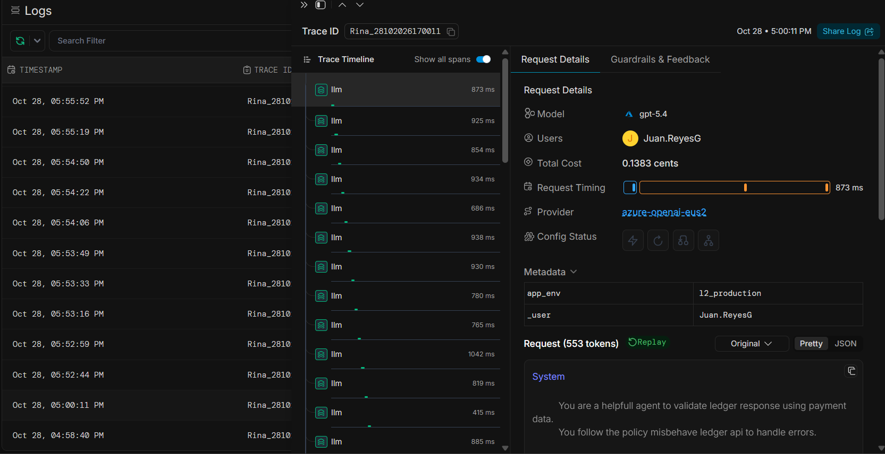

# L1 Reflection document

## 1. What Was Built - description of the system/project built

### Tech stack

For the agent the tech stack used was the proposed by the Capstone:  

- Langgraph
- Pytest-Asyncio
- Portkey

### The Graph design

Followed the suggested flow in the agent_skeleton.py with the use of tools to allow each node to have extra capability to perform actions as needed.

### Observability

For Traceability, I used the portkey observality capabilities in order for Rina (or any user) to be able to trace the Model reasoning for all the Payments processing:

Once the user gets access to the agent the Portkey is configured then they will have access to Observability portal to review Agent reasoning

## 2. Why - rationale/approach decisions and design choices

Identify the top criteria for the agent:
**Provide consistent processing for payments to allow safe reconciliation in accountant department**

The approach was:

1. Understand the Data set and API scenarios by building the EXPLORATION.md
2. Design a structured processing by using langGraph to handle each step
3. Implement each node of the designed Graph
4. Create a set of unit test for each node to be able to control the behaviour and consistency of the processing flow
5. Create unit test for whole agent to keep the results consistent and safe
6. Perform manual test and record results in Exploration and identify errors
7. Improve agent and iterate unit test and manual test process

## 3. What Failed - documented failures, bugs, or challenges encountered

This is a history of the identified errors during development, that were improved iteratively:

| Payment ID | Order ID  |API Response| Expected Result           | Actual Result        | Diagnosis |
|------------|-----------|---|---------------------------|----------------------|---|
| PAY-4011   | ORD-70011 |OK| Duplicate settlement      | Reconcile | No memory system to know previously processed payments |
| PAY-4020   | ORD-70020 |OK (After 2 attempts)|   RECONCILED              | RECONCILED  | loaded policy loaded as json |
| PAY-4017   | ORD-70017 |OK (Absolute amount)|   RECONCILED (refund)         | Amount Missmatch | loaded policy loaded as json | 
| PAY-4013   | ORD-70013 |OK| Unmatched payment         | Duplicate settlement    | System prompt conflict  |

## 4. How It Was Fixed - fixes applied and how issues were resolved

Based on the Diagnosis of the issues found during the development process the following are the fixed applied:

**loaded policy loaded as json**: At first I loaded the markdown as json and passed to the model as json, which introduced Json chars that caused the agent to not follow loaded policy correctly which allowed the agent to follow rule precisely.

**No memory system to know previously processed payments**: Use LangGrapg storage process to keep an in-memory storage of correctly reconciled payments and be able to identify duplicate payments

## 5. What Would Be Done Differently - alternative approaches or improvements

The current approach force the agent to follow a specific flow process in order to provided consistent results and auditability.
As an alternative I could have used a deep agent or harness of agents that interact with each other to follow the policy and see if the processing flow is capable of giving consistent results.

## 6. Business Impact - real-world impact or lessons learned

The best lesson from this Capstone project was to create a proper methodology to implement an agent with general capability and consistent results to be safe to used on system like the payment scenario were the auditability is Key.

AI agents are really adaptable for similar process however a careful process is needed to be able to focus the agent into providing consistent results.
